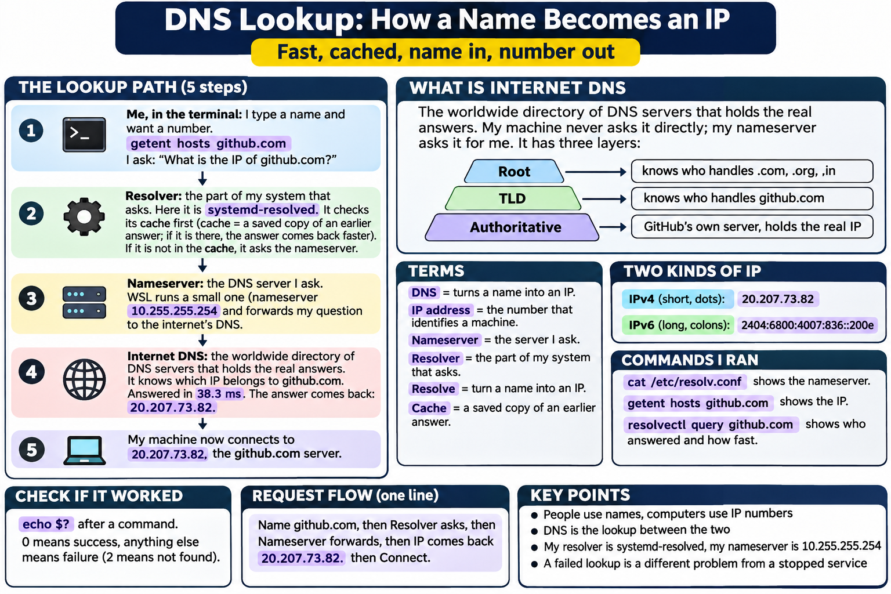

# Day 4 - Networking: DNS (4 Nov 2026)

## What DNS does
DNS turns a name (github.com) into an IP address (20.207.73.82). People use names, computers use numbers.

## The lookup path
1. Me, in the terminal: I ask for the IP of github.com (getent hosts github.com).
2. Resolver (systemd-resolved): the part of my system that asks. It checks its cache first (a saved copy of an earlier answer).
3. Nameserver (10.255.255.254): the DNS server I ask. WSL generates it and forwards my question.
4. Internet DNS: the worldwide directory of DNS servers that holds the real answers. It has three layers: Root (who handles .com, .org, .in), TLD (who handles github.com) and Authoritative (GitHub's own server, holds the real IP). My machine never asks it directly; my nameserver asks it for me.
5. The IP comes back and my machine connects to it.

## Terms
- DNS: turns a name into an IP
- IP address: the number that identifies a machine
- Nameserver: the server I ask
- Resolver: the part of my system that asks
- Resolve: turn a name into an IP
- Cache: a saved copy of an earlier answer
- IPv4: short, with dots (20.207.73.82)
- IPv6: long, with colons (2404:6800:4007:836::200e)

## What I ran and what I saw
    cat /etc/resolv.conf              -> nameserver 10.255.255.254
    getent hosts github.com           -> 20.207.73.82 github.com
    resolvectl query github.com       -> first: 38.3 ms, second: 18.7 ms
    getent hosts <fake domain>        -> no output
    echo $?                           -> 2 (not found)
    getent hosts github.com ; echo $? -> 0 (success)

## What I learned
- The second lookup was faster (18.7 ms vs 38.3 ms) but still said "Data from: network", so it was NOT a cache hit in my resolver. The nameserver probably had the answer saved.
- A failed lookup prints nothing. The only sign of failure is the exit code (2 = not found, 0 = success).
- Typing echo$? without a space makes bash replace $? with the number (echo2). Always write: echo $?
- A failed DNS lookup is a different problem from a stopped service.

## Test next
- Check when resolvectl shows "Data from: cache" (the resolver cache).

## Picture

## Ports (4 Nov 2026)
- IP address = address of the building. Port = door number inside it, so traffic reaches the right program.
- Port: a number (0 to 65535) that identifies which program should receive the traffic.
- Listening: a program is waiting at its port for connections.
- Socket: IP address + port, for example 20.207.73.82:443.
- Common ports: 22 SSH, 53 DNS, 80 HTTP, 443 HTTPS.

## TCP and UDP
- TCP: like a phone call. Sets up a connection first, checks every piece arrived in order, resends lost pieces. Slower but reliable. Used for web (HTTP/HTTPS), SSH, GitHub, email, downloads.
- UDP: like posting a letter. No connection, no checking, no resend. Faster and lighter. Used for small DNS questions, video calls, streaming, games, time sync.
- DNS shows up under both: small questions use UDP, larger answers use TCP.

## What I ran: ss -tulnp
    ss -tuln     -> t = TCP, u = UDP, l = listening, n = numbers not names
    sudo ss -tulnp  -> adds the Process column (program that owns the port)
- Port 53 appears on both UDP and TCP.
- 127.0.0.53:53 and 127.0.0.54:53 are owned by systemd-resolve (pid 166). This is my resolver.
- 10.255.255.254:53 is the WSL nameserver (from /etc/resolv.conf). No process shown: it is provided by WSL, not by a program inside my Ubuntu.
- UDP 323 on 127.0.0.1 and [::1]: no process shown, owner not confirmed.
- 127.x.x.x (loopback) is reachable only from this machine. 0.0.0.0 would mean reachable from anywhere. Nothing of mine was open to the internet.
- A blank Process column means the owner is not visible from inside this Ubuntu, not that nobody owns the port.
- Port 22 not listening: I use SSH to connect out to GitHub, I do not run an SSH server.

## Test next
- Find out who owns UDP 323.
